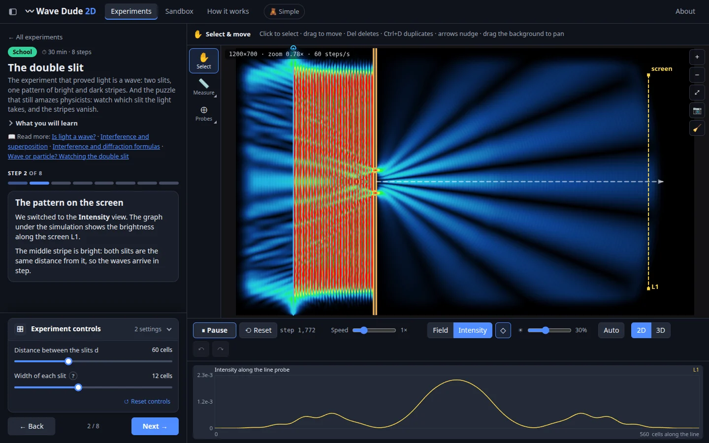
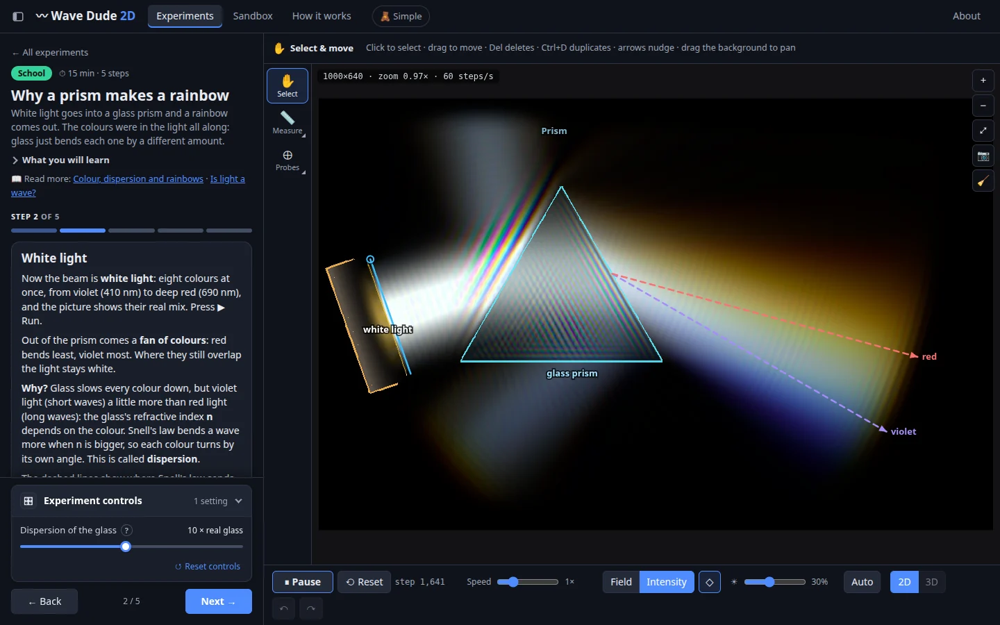
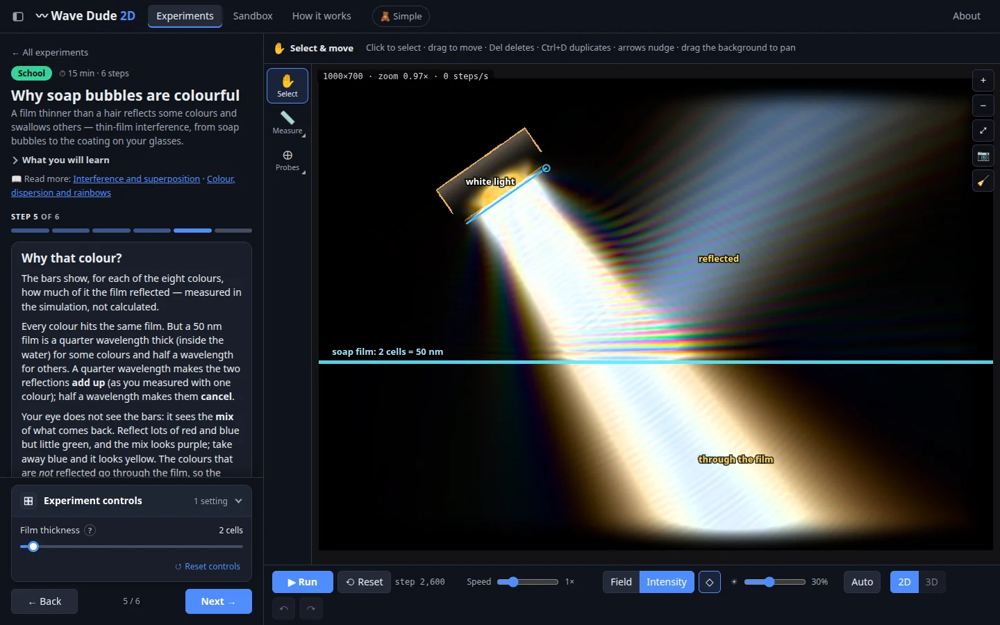
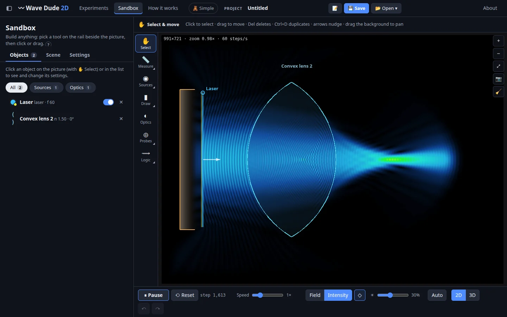
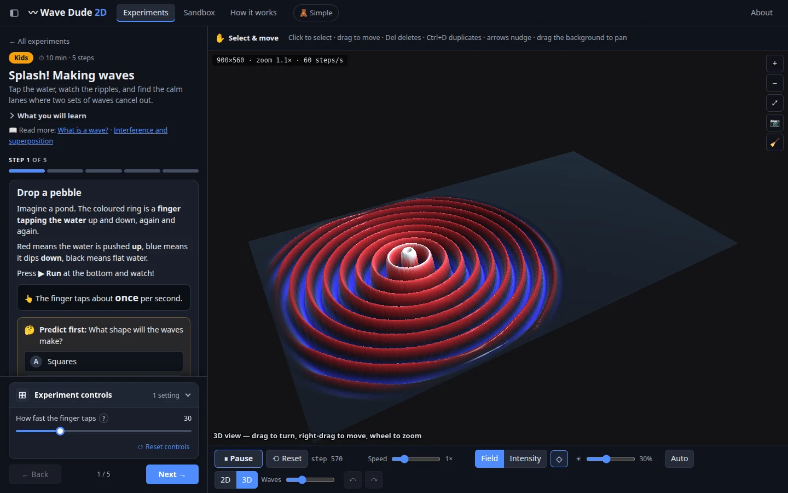
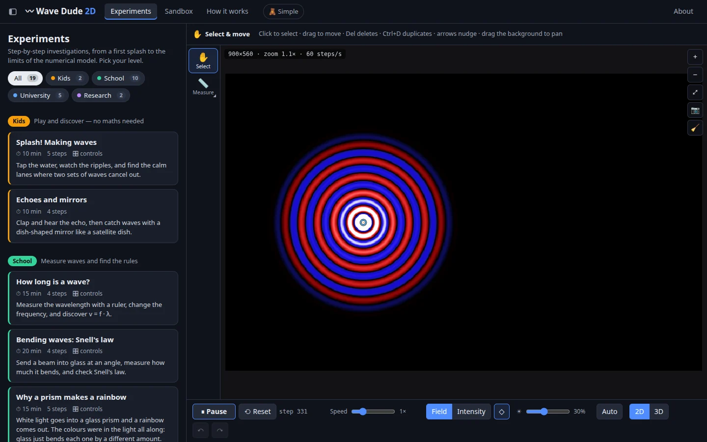
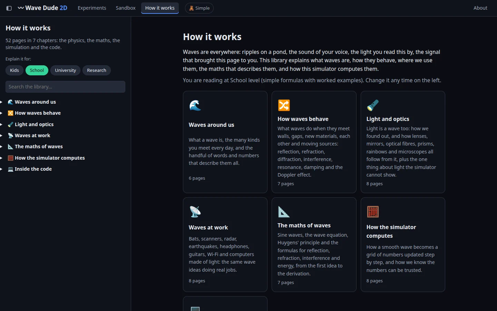

# Wave's on the web

An interactive 2D & 3D wave simulator that runs in the browser (WebGL2, nothing to install). Draw a scene, add wave sources, glass, mirrors and walls, and watch the waves move, bend, interfere and diffract. It comes with guided experiments for every level, from kids to researchers, a free sandbox, and "How it works" pages on the physics, the maths and the code.

**Status:** not online yet. It will be hosted soon; until then you can run it yourself (see below).

## Screenshots



**The double slit:** waves through two slits make bright and dark stripes, and the graph measures them along the screen.

<table>
<tr>
<td width="50%"><br><b>Why a prism makes a rainbow:</b> white light as eight colours at once, each bent by its own angle.</td>
<td width="50%"><br><b>Why soap bubbles are colourful:</b> a film 50 nm thick reflects some colours and lets the others through.</td>
</tr>
<tr>
<td><br><b>Sandbox:</b> build your own scene. Here a laser and a lens make a focus.</td>
<td><br><b>3D view:</b> the waves as a surface you can turn and zoom.</td>
</tr>
<tr>
<td><br><b>19 guided experiments</b> for Kids, School, University and Research.</td>
<td><br><b>How it works:</b> 52 pages on the physics, the maths and the code, at four levels.</td>
</tr>
</table>

## Where it comes from

This project is a port of other people's work to the web:

**[WaveSimulator2D](https://github.com/0x23/WaveSimulator2D)** (Python) → **Wave Dude 2D** (Windows) → **this project** (browser)

- **Original repo: [WaveSimulator2D](https://github.com/0x23/WaveSimulator2D)** by 0x23 ([DiffractionLimited](https://www.youtube.com/@DiffractionLimited) on YouTube). A fast 2D wave simulator in Python that runs on the GPU (CuPy), and the script that inspired Wave Dude 2D. The wave step, the scene rules (a scene is an image whose colours set the glass, the walls and the sources, like [this lens and double slit](https://github.com/0x23/WaveSimulator2D/blob/main/example_data/scene_lens_doubleslit.png)) and the field and intensity pictures all start here.
- **Wave Dude 2D** by JJM Vleggaar ([Huygens Optics](https://www.huygensoptics.com)). Built on WaveSimulator2D as a Windows app (VB.NET, OpenCL) with a full interface, probes, many kinds of sources and video export. The app, example projects and its source code (GPL-3.0) are downloads on huygensoptics.com, linked from his tutorial video *Making Wave Visuals the Easy Way* on the Huygens Optics YouTube channel. This project started from that source code (V0.29) and aims to bring its code, its ideas and its experiments to the browser, so anyone can use it without installing anything. You can support his work on [Patreon](https://www.patreon.com/c/huygens_optics).
- The colour schemes come from Wave Dude 2D, which sampled most of them from [matplotlib](https://matplotlib.org/) and [seaborn](https://seaborn.pydata.org/) colour maps and two from WaveSimulator2D.
- Video export uses [Mediabunny](https://mediabunny.dev) (MPL-2.0).

All credit for the original ideas goes to them.

## Made with AI, not verified

The code of this web version was written with AI (Claude, by Anthropic). It has **not** been reviewed or verified by people, so expect bugs, and check numbers and explanations before relying on them.

It is meant for people to play with, learn from and improve. Issues and pull requests are welcome.

## Run it

```sh
npm install
npm run dev        # development server with hot reload
npm run build      # static site in dist/
npm run preview    # serve dist/ on http://localhost:4173
```

The built `dist/` folder is a plain static site: any web server can host it (it does not work from `file://`).

## Docker

```sh
docker compose up -d --build                    # http://localhost:8090 (bound to 127.0.0.1 only; WAVE_DUDE_PORT in .env changes it)
```

## Licence

GPL-3.0-or-later, like Wave Dude 2D: see [LICENSE](LICENSE). Keep it open source: you may use, study, change and share it, and if you share a changed version, share its source under the same licence.
